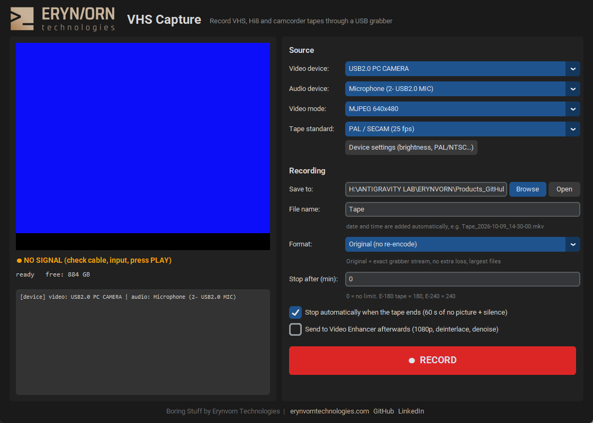

<p align="center">
  <a href="https://erynvorntechnologies.com"></a>
</p>

# 📼 VHS Capture

<p>
  <a href="https://erynvorntechnologies.com">Website</a> ·
  <a href="https://github.com/ErynVornTechnologies">GitHub</a> ·
  <a href="https://www.linkedin.com/in/kamil-krzysztof-nagorski/">LinkedIn</a>
</p>

Digitise VHS, Hi8, Video8 and camcorder tapes with a cheap USB video grabber
(EasyCap-style). Plug in the VCR, press **RECORD**, walk away. The recording
stops by itself when the tape ends.

Part of the **Boring Stuff** series: small, useful tools that do one dull job
well. It pairs with [Video Enhancer](https://github.com/ErynVornTechnologies/Video-Enhancer), which turns the
capture into clean 1080p.

<p align="center"></p>

## 🌟 Features

- **Finds your grabber automatically**, and the webcam is skipped. Video and audio
  inputs are matched for you.
- **Listen on your PC speakers** while previewing and recording, with its own
  volume slider. It doesn't affect the recorded audio.
- **Live preview** with an audio level bar and a clear **NO SIGNAL** indicator.
  Grabbers show a black or blue screen without input; both are detected.
- **No quality loss.** Most USB grabbers already compress to MJPEG in hardware.
  The app stores that stream byte for byte (no re-encode, almost no CPU) with
  lossless FLAC audio.
- **Crash-safe MKV files.** If the PC or the app dies, everything recorded so far still plays.
- **Choose where to save.** The default is the `captures` folder inside the app.
  File names get the date and time added (`Tape_2026-10-09_14-30-00.mkv`).
- **Unattended recording**: stop after N minutes (the tape length), and/or stop
  automatically after 60 s of no picture and silence (end of tape).
- **Honest timing.** Frames are time-stamped by the PC clock, so a grabber that
  free-runs without a signal can't stretch or desync the file.
- **One-click hand-off to Video Enhancer** (if it sits next to this folder):
  after recording, the tape is deinterlaced and upscaled to 1080p automatically.
- Live stats: elapsed time, file size, GB per hour, hours of disk left, and
  frames dropped by the PC.

## 🛠️ Requirements

- Windows 10/11
- A USB video grabber (UVC / DirectShow). Developed with an Arkmicro
  `USB2.0 PC CAMERA` (VID 18EC, PID 5555), which outputs MJPEG 640x480 plus 44.1 kHz stereo.
- Python 3.12 and FFmpeg (`INSTALL.bat` installs both via winget if missing).
- No GPU needed.

## 🚀 Installation

```bat
git clone https://github.com/ErynVornTechnologies/VHS-Capture.git
cd VHS-Capture
INSTALL.bat
```

`INSTALL.bat` creates a private `.venv`, installs three small packages and
lists the capture devices it can see.

## 🎮 How to use

1. Connect the VCR or camcorder to the grabber (yellow = video, white/red = audio).
2. Double-click **`run.bat`**. The preview starts by itself.
3. Press PLAY on the VCR. The indicator should turn to **signal OK** and the
   audio bar should move.
4. Pick the folder and a file name, set **Stop after** to the tape length,
   leave **Stop automatically when the tape ends** on.
5. Rewind the tape, start it, and press **● RECORD**. The recording stops when
   you press STOP, when the time limit is reached, or when the tape runs out.

**Picture too dark or no colour?** Click *Device settings*: the grabber's own
dialog has brightness and contrast, and on many models the PAL/NTSC video standard.

### Command line

```bat
.venv\Scripts\python.exe capture.py --list
.venv\Scripts\python.exe capture.py --name "Holiday 1998" --minutes 185
.venv\Scripts\python.exe capture.py --folder D:\Tapes --format h264 --auto-stop 90
```

## ⚙️ How it works

```
DirectShow (video + audio in ONE input, PC-clock timestamps)
   ├─► MKV: MJPEG stream-copied (or H.264 / FFV1) + FLAC audio
   └─► preview pipe: 12 fps 480x360 + showvolume bar ─► GUI
         + silencedetect events on stderr; flat-picture check in Python
```

- A single ffmpeg process keeps audio and video on the same clock.
- STOP sends `q` to ffmpeg, so the MKV is closed with a proper index.
- "No signal" = per-channel pixel variance near zero, so black and blue screens both count.
- Auto-stop needs **both** no picture and silence for 60 s, so a quiet dark
  scene in the film won't end the recording.

## 📏 Formats

| Format | What it does | When |
|---|---|---|
| Original (default) | Grabber's MJPEG copied as-is, FLAC audio | Best quality, archive master |
| Compact H.264 | Re-encodes (x264 CRF 16, veryfast) | Smaller files, uses some CPU |
| Lossless FFV1 | Lossless, for grabbers that output raw YUY2 | Raw-output grabbers only |

## 🚧 Limitations

- Many cheap grabbers deliver only 640x480, so a PAL picture (576 lines) is
  scaled inside the device. It's fine for a 1080p upscale, but not an archival-grade transfer.
- Grabbers without a time-base corrector can't fix unstable VHS tracking.
  Clean the heads and use a VCR with TBC/DNR for the best results.
- Auto-stop relies on the grabber showing a flat screen when the tape ends. A
  VCR that outputs snow or noise after the tape end is caught by the time limit instead.
- Windows only (DirectShow).

## 📄 Licence

Code: MIT (see `LICENSE`). Erynvorn logo and name: © Erynvorn Technologies, not
covered by the MIT licence.

---

<p align="center">
  <a href="https://erynvorntechnologies.com"></a><br>
  Built by <a href="https://erynvorntechnologies.com"><b>Erynvorn Technologies</b></a>: sovereign, on-premise AI.<br>
  More Boring Stuff on <a href="https://github.com/ErynVornTechnologies">GitHub</a>
  and <a href="https://www.linkedin.com/in/kamil-krzysztof-nagorski/">LinkedIn</a>.
</p>
